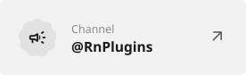
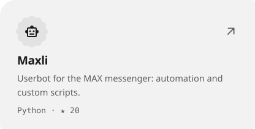
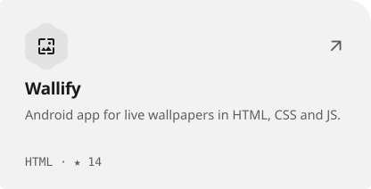
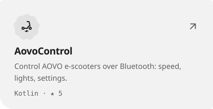
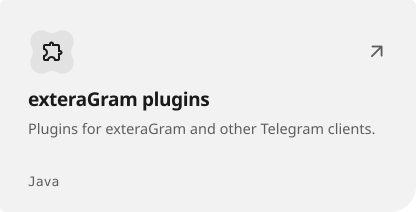

<picture><source media="(prefers-color-scheme: dark)" srcset="assets/hero-dark-1b9e3187.svg"></picture>

<a href="https://t.me/YouRooni"><picture><source media="(prefers-color-scheme: dark)" srcset="assets/link-telegram-dark-f69b080b.svg"></picture></a>&nbsp;<a href="https://t.me/RnPlugins"><picture><source media="(prefers-color-scheme: dark)" srcset="assets/link-channel-dark-d44b47c9.svg"></picture></a>&nbsp;<a href="https://rooni.dev"><picture><source media="(prefers-color-scheme: dark)" srcset="assets/link-site-dark-6032d0b1.svg"></picture></a>

<a href="https://github.com/YouRooni/Maxli"><picture><source media="(prefers-color-scheme: dark)" srcset="assets/project-maxli-dark-64f3749f.svg"></picture></a>&nbsp;<a href="https://github.com/YouRooni/Wallify-Repo"><picture><source media="(prefers-color-scheme: dark)" srcset="assets/project-wallify-repo-dark-bf2a2daa.svg"></picture></a> <a href="https://github.com/YouRooni/AovoControl"><picture><source media="(prefers-color-scheme: dark)" srcset="assets/project-aovocontrol-dark-c3c4d105.svg"></picture></a>&nbsp;<a href="https://github.com/YouRooni/plugins"><picture><source media="(prefers-color-scheme: dark)" srcset="assets/project-plugins-dark-d8107c1c.svg"></picture></a>

