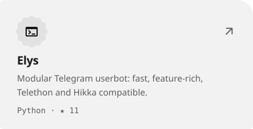
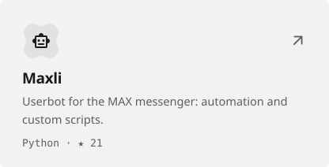
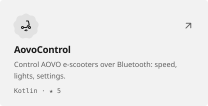
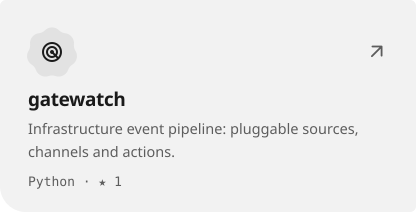
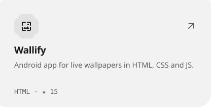

<picture><source media="(prefers-color-scheme: dark)" srcset="assets/hero-dark-d2738dd0.svg"></picture>

<a href="https://t.me/YouRooni"><picture><source media="(prefers-color-scheme: dark)" srcset="assets/link-telegram-dark-6b5475f3.svg"></picture></a>&nbsp;<a href="https://t.me/RnPlugins"><picture><source media="(prefers-color-scheme: dark)" srcset="assets/link-channel-dark-4f0449b1.svg"></picture></a>&nbsp;<a href="https://rooni.dev"><picture><source media="(prefers-color-scheme: dark)" srcset="assets/link-site-dark-54493cbf.svg"></picture></a>

<a href="https://github.com/YouRooni/Zefir"><picture><source media="(prefers-color-scheme: dark)" srcset="assets/project-zefir-dark-74fe2543.svg"></picture></a>&nbsp;<a href="https://github.com/ZavozDevs/Elys"><picture><source media="(prefers-color-scheme: dark)" srcset="assets/project-elys-dark-ae0eea79.svg"></picture></a> <a href="https://github.com/YouRooni/Maxli"><picture><source media="(prefers-color-scheme: dark)" srcset="assets/project-maxli-dark-d1783dd0.svg"></picture></a>&nbsp;<a href="https://github.com/YouRooni/AovoControl"><picture><source media="(prefers-color-scheme: dark)" srcset="assets/project-aovocontrol-dark-cb6c7714.svg"></picture></a> <a href="https://github.com/YouRooni/gatewatch"><picture><source media="(prefers-color-scheme: dark)" srcset="assets/project-gatewatch-dark-7b92ca54.svg"></picture></a>&nbsp;<a href="https://github.com/YouRooni/Wallify-Repo"><picture><source media="(prefers-color-scheme: dark)" srcset="assets/project-wallify-repo-dark-1db250fa.svg"></picture></a>

