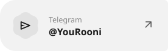
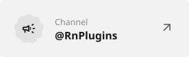

<picture><source media="(prefers-color-scheme: dark)" srcset="assets/hero-dark.svg"></picture>

<a href="https://t.me/YouRooni"><picture><source media="(prefers-color-scheme: dark)" srcset="assets/link-telegram-dark.svg"></picture></a>&nbsp;<a href="https://t.me/RnPlugins"><picture><source media="(prefers-color-scheme: dark)" srcset="assets/link-channel-dark.svg"></picture></a>&nbsp;<a href="https://rooni.dev"><picture><source media="(prefers-color-scheme: dark)" srcset="assets/link-site-dark.svg"></picture></a>

<a href="https://github.com/YouRooni/Maxli"><picture><source media="(prefers-color-scheme: dark)" srcset="assets/project-maxli-dark.svg"></picture></a>&nbsp;<a href="https://github.com/YouRooni/Wallify-Repo"><picture><source media="(prefers-color-scheme: dark)" srcset="assets/project-wallify-repo-dark.svg"></picture></a> <a href="https://github.com/YouRooni/AovoControl"><picture><source media="(prefers-color-scheme: dark)" srcset="assets/project-aovocontrol-dark.svg"></picture></a>&nbsp;<a href="https://github.com/YouRooni/plugins"><picture><source media="(prefers-color-scheme: dark)" srcset="assets/project-plugins-dark.svg"></picture></a>

