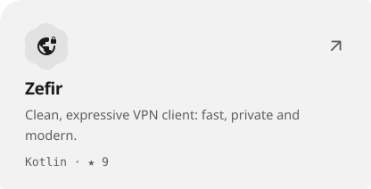
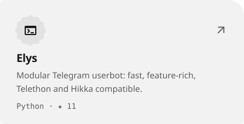
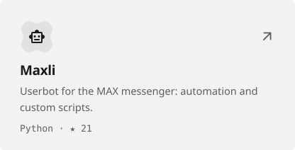
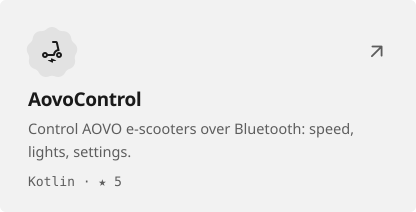
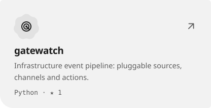
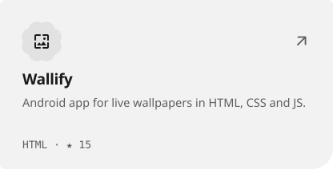

<picture><source media="(prefers-color-scheme: dark)" srcset="assets/hero-dark-3fb89048.svg"></picture>

<a href="https://t.me/YouRooni"><picture><source media="(prefers-color-scheme: dark)" srcset="assets/link-telegram-dark-8ef83241.svg"></picture></a>&nbsp;<a href="https://t.me/RnPlugins"><picture><source media="(prefers-color-scheme: dark)" srcset="assets/link-channel-dark-303d251c.svg"></picture></a>&nbsp;<a href="https://rooni.dev"><picture><source media="(prefers-color-scheme: dark)" srcset="assets/link-site-dark-207cdbda.svg"></picture></a>

<a href="https://github.com/YouRooni/Zefir"><picture><source media="(prefers-color-scheme: dark)" srcset="assets/project-zefir-dark-9e0a4271.svg"></picture></a>&nbsp;<a href="https://github.com/ZavozDevs/Elys"><picture><source media="(prefers-color-scheme: dark)" srcset="assets/project-elys-dark-3b78ba0c.svg"></picture></a> <a href="https://github.com/YouRooni/Maxli"><picture><source media="(prefers-color-scheme: dark)" srcset="assets/project-maxli-dark-db18bacf.svg"></picture></a>&nbsp;<a href="https://github.com/YouRooni/AovoControl"><picture><source media="(prefers-color-scheme: dark)" srcset="assets/project-aovocontrol-dark-6da43d1c.svg"></picture></a> <a href="https://github.com/YouRooni/gatewatch"><picture><source media="(prefers-color-scheme: dark)" srcset="assets/project-gatewatch-dark-ec378588.svg"></picture></a>&nbsp;<a href="https://github.com/YouRooni/Wallify-Repo"><picture><source media="(prefers-color-scheme: dark)" srcset="assets/project-wallify-repo-dark-6e62aa66.svg"></picture></a>

