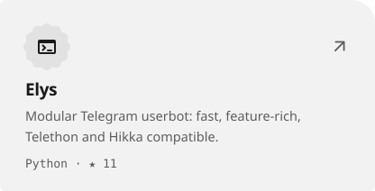
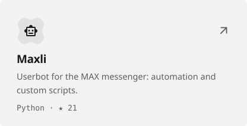
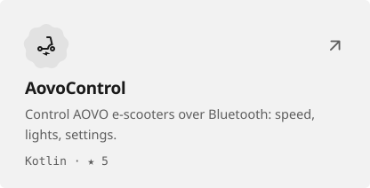
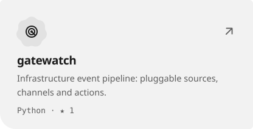
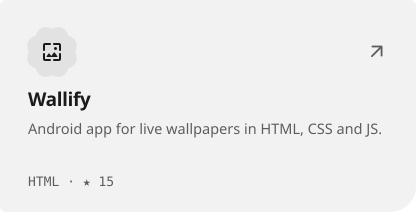

<picture><source media="(prefers-color-scheme: dark)" srcset="assets/hero-dark-df961e2e.svg"></picture>

<a href="https://t.me/YouRooni"><picture><source media="(prefers-color-scheme: dark)" srcset="assets/link-telegram-dark-022db1c5.svg"></picture></a>&nbsp;<a href="https://t.me/RnPlugins"><picture><source media="(prefers-color-scheme: dark)" srcset="assets/link-channel-dark-46645fd0.svg"></picture></a>&nbsp;<a href="https://rooni.dev"><picture><source media="(prefers-color-scheme: dark)" srcset="assets/link-site-dark-0223f216.svg"></picture></a>

<a href="https://github.com/YouRooni/Zefir"><picture><source media="(prefers-color-scheme: dark)" srcset="assets/project-zefir-dark-81b3e128.svg"></picture></a>&nbsp;<a href="https://github.com/ZavozDevs/Elys"><picture><source media="(prefers-color-scheme: dark)" srcset="assets/project-elys-dark-e6c37098.svg"></picture></a> <a href="https://github.com/YouRooni/Maxli"><picture><source media="(prefers-color-scheme: dark)" srcset="assets/project-maxli-dark-5b5a370d.svg"></picture></a>&nbsp;<a href="https://github.com/YouRooni/AovoControl"><picture><source media="(prefers-color-scheme: dark)" srcset="assets/project-aovocontrol-dark-f7345744.svg"></picture></a> <a href="https://github.com/YouRooni/gatewatch"><picture><source media="(prefers-color-scheme: dark)" srcset="assets/project-gatewatch-dark-6bb2df68.svg"></picture></a>&nbsp;<a href="https://github.com/YouRooni/Wallify-Repo"><picture><source media="(prefers-color-scheme: dark)" srcset="assets/project-wallify-repo-dark-b142a979.svg"></picture></a>

