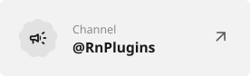
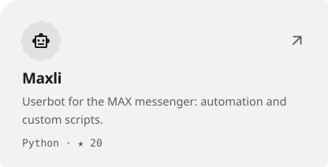
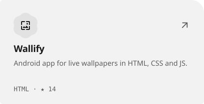
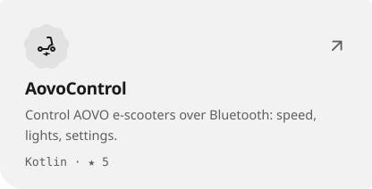
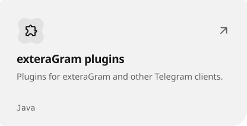

<picture><source media="(prefers-color-scheme: dark)" srcset="assets/hero-dark-19119f8e.svg"></picture>

<a href="https://t.me/YouRooni"><picture><source media="(prefers-color-scheme: dark)" srcset="assets/link-telegram-dark-39d123e0.svg"></picture></a>&nbsp;<a href="https://t.me/RnPlugins"><picture><source media="(prefers-color-scheme: dark)" srcset="assets/link-channel-dark-62a6912a.svg"></picture></a>&nbsp;<a href="https://rooni.dev"><picture><source media="(prefers-color-scheme: dark)" srcset="assets/link-site-dark-e4782b99.svg"></picture></a>

<a href="https://github.com/YouRooni/Maxli"><picture><source media="(prefers-color-scheme: dark)" srcset="assets/project-maxli-dark-140b4d81.svg"></picture></a>&nbsp;<a href="https://github.com/YouRooni/Wallify-Repo"><picture><source media="(prefers-color-scheme: dark)" srcset="assets/project-wallify-repo-dark-e3ee3d57.svg"></picture></a> <a href="https://github.com/YouRooni/AovoControl"><picture><source media="(prefers-color-scheme: dark)" srcset="assets/project-aovocontrol-dark-d6f6002b.svg"></picture></a>&nbsp;<a href="https://github.com/YouRooni/plugins"><picture><source media="(prefers-color-scheme: dark)" srcset="assets/project-plugins-dark-3de125a8.svg"></picture></a>

