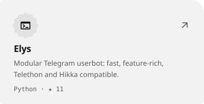
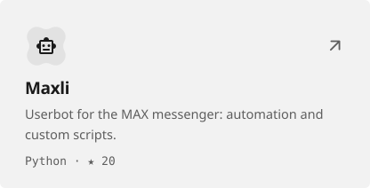
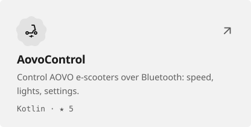
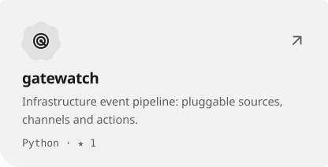
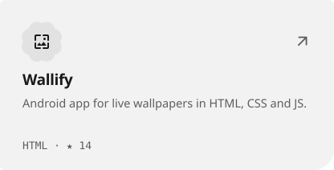

<picture><source media="(prefers-color-scheme: dark)" srcset="assets/hero-dark-5689a599.svg"></picture>

<a href="https://t.me/YouRooni"><picture><source media="(prefers-color-scheme: dark)" srcset="assets/link-telegram-dark-0975d102.svg"></picture></a>&nbsp;<a href="https://t.me/RnPlugins"><picture><source media="(prefers-color-scheme: dark)" srcset="assets/link-channel-dark-47806b5e.svg"></picture></a>&nbsp;<a href="https://rooni.dev"><picture><source media="(prefers-color-scheme: dark)" srcset="assets/link-site-dark-6406793d.svg"></picture></a>

<a href="https://github.com/YouRooni/Zefir"><picture><source media="(prefers-color-scheme: dark)" srcset="assets/project-zefir-dark-28981bcb.svg"></picture></a>&nbsp;<a href="https://github.com/ZavozDevs/Elys"><picture><source media="(prefers-color-scheme: dark)" srcset="assets/project-elys-dark-6ccf4f93.svg"></picture></a> <a href="https://github.com/YouRooni/Maxli"><picture><source media="(prefers-color-scheme: dark)" srcset="assets/project-maxli-dark-a4daf592.svg"></picture></a>&nbsp;<a href="https://github.com/YouRooni/AovoControl"><picture><source media="(prefers-color-scheme: dark)" srcset="assets/project-aovocontrol-dark-92ec310d.svg"></picture></a> <a href="https://github.com/YouRooni/gatewatch"><picture><source media="(prefers-color-scheme: dark)" srcset="assets/project-gatewatch-dark-123815c1.svg"></picture></a>&nbsp;<a href="https://github.com/YouRooni/Wallify-Repo"><picture><source media="(prefers-color-scheme: dark)" srcset="assets/project-wallify-repo-dark-190ce70f.svg"></picture></a>

