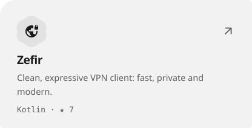
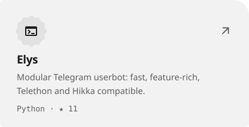
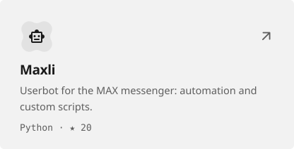
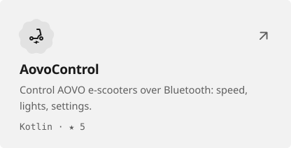
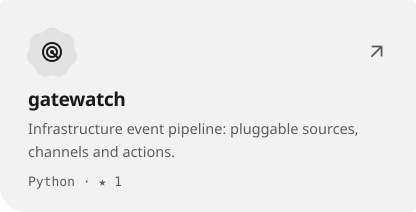

<picture><source media="(prefers-color-scheme: dark)" srcset="assets/hero-dark-1790d348.svg"></picture>

<a href="https://t.me/YouRooni"><picture><source media="(prefers-color-scheme: dark)" srcset="assets/link-telegram-dark-cc748684.svg"></picture></a>&nbsp;<a href="https://t.me/RnPlugins"><picture><source media="(prefers-color-scheme: dark)" srcset="assets/link-channel-dark-54208806.svg"></picture></a>&nbsp;<a href="https://rooni.dev"><picture><source media="(prefers-color-scheme: dark)" srcset="assets/link-site-dark-f41db2ef.svg"></picture></a>

<a href="https://github.com/YouRooni/Zefir"><picture><source media="(prefers-color-scheme: dark)" srcset="assets/project-zefir-dark-e95754a6.svg"></picture></a>&nbsp;<a href="https://github.com/ZavozDevs/Elys"><picture><source media="(prefers-color-scheme: dark)" srcset="assets/project-elys-dark-97b7c2e3.svg"></picture></a> <a href="https://github.com/YouRooni/Maxli"><picture><source media="(prefers-color-scheme: dark)" srcset="assets/project-maxli-dark-ae4e9685.svg"></picture></a>&nbsp;<a href="https://github.com/YouRooni/AovoControl"><picture><source media="(prefers-color-scheme: dark)" srcset="assets/project-aovocontrol-dark-cc3e0fd8.svg"></picture></a> <a href="https://github.com/YouRooni/gatewatch"><picture><source media="(prefers-color-scheme: dark)" srcset="assets/project-gatewatch-dark-4aadfb0c.svg"></picture></a>&nbsp;<a href="https://github.com/YouRooni/Wallify-Repo"><picture><source media="(prefers-color-scheme: dark)" srcset="assets/project-wallify-repo-dark-f0bef38f.svg"></picture></a>

