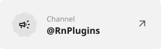
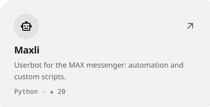
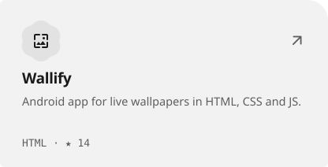
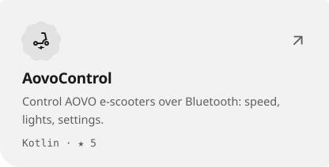
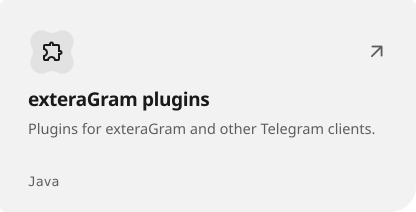

<picture><source media="(prefers-color-scheme: dark)" srcset="assets/hero-dark-50cef1d1.svg"></picture>

<a href="https://t.me/YouRooni"><picture><source media="(prefers-color-scheme: dark)" srcset="assets/link-telegram-dark-2a2c803b.svg"></picture></a>&nbsp;<a href="https://t.me/RnPlugins"><picture><source media="(prefers-color-scheme: dark)" srcset="assets/link-channel-dark-e5e2368e.svg"></picture></a>&nbsp;<a href="https://rooni.dev"><picture><source media="(prefers-color-scheme: dark)" srcset="assets/link-site-dark-edf49da0.svg"></picture></a>

<a href="https://github.com/YouRooni/Maxli"><picture><source media="(prefers-color-scheme: dark)" srcset="assets/project-maxli-dark-e67c87f5.svg"></picture></a>&nbsp;<a href="https://github.com/YouRooni/Wallify-Repo"><picture><source media="(prefers-color-scheme: dark)" srcset="assets/project-wallify-repo-dark-f1cbc3fa.svg"></picture></a> <a href="https://github.com/YouRooni/AovoControl"><picture><source media="(prefers-color-scheme: dark)" srcset="assets/project-aovocontrol-dark-c3948ba0.svg"></picture></a>&nbsp;<a href="https://github.com/YouRooni/plugins"><picture><source media="(prefers-color-scheme: dark)" srcset="assets/project-plugins-dark-6407c829.svg"></picture></a>

